
<a href="README.md">한국어</a> · <b>English</b>

<a href="https://sovis-team.github.io/en/"></a>

I build **SoundVisualizer**, an accessibility app for deaf and hard-of-hearing people.
[Android](https://github.com/SOVIS-Team/SoundVisualizer-Android) · [Windows](https://github.com/SOVIS-Team/SoundVisualizer-Windows) · [Website](https://sovis-team.github.io/en/) · [Video](https://youtu.be/Rl8BLXjoTv4)

 

<picture>
  <source media="(prefers-color-scheme: dark)" srcset="assets/en/showcase-dark.svg">
  
</picture>

SoundVisualizer listens to the sound your device plays and draws **where it comes from**, **how loud it is** and **what kind of sound it is** along the edges of the screen. It works over any screen (video, music, games), and touches and clicks pass straight through to the app underneath. An on-device AI tells the kinds of sound apart, and no sound leaves the device.

Pick a sound to see what the app really drew.

<b>Ambient</b> · white

 
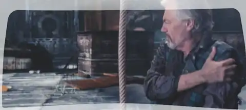

Sounds in the background, such as music, rain or a passing car. The louder the sound, the thicker the ripple at the edge.

<b>Human sounds</b> · yellow

 
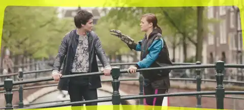

Speech, laughter, coughing and other sounds people make. When someone starts to speak, yellow appears before the full result is in, so the display does not lag behind.

<b>Danger</b> · red

 
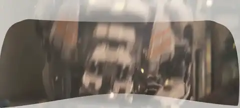

Sirens, alarms, car horns and gunshots. On a phone it can also vibrate, and when the screen is locked it puts an alert on the lock screen.

 

### Work

<a href="https://github.com/SOVIS-Team">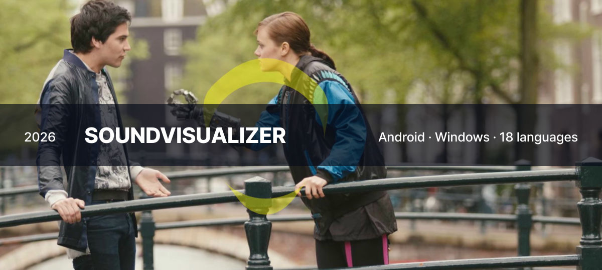</a><a href="https://github.com/amophi/android-panel">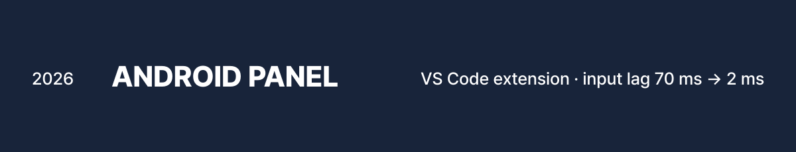</a><a href="https://yj720.itch.io/the-ultimate-hardcore-convenience-store">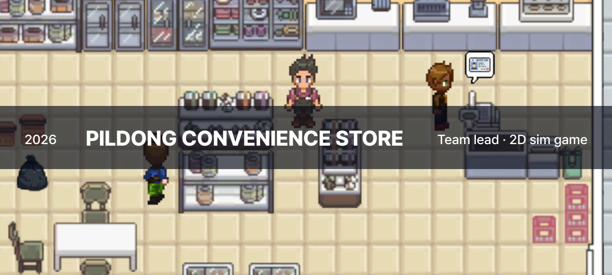</a><a href="https://github.com/amophi/Solarljos">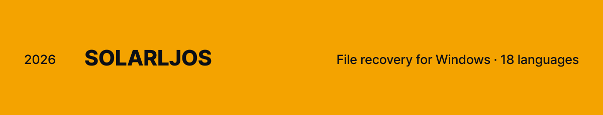</a><a href="https://github.com/DguFarmSystem/4th-game-High-School-High-Score">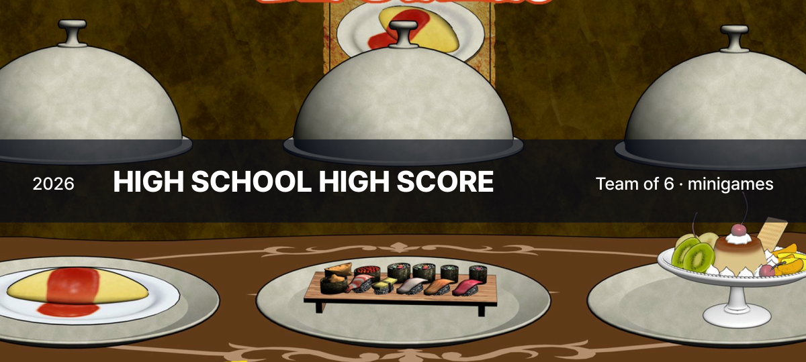</a><a href="https://www.gcsweb.kr">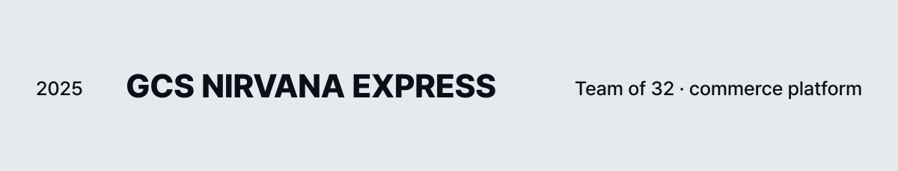</a><a href="https://github.com/amophi/Netson">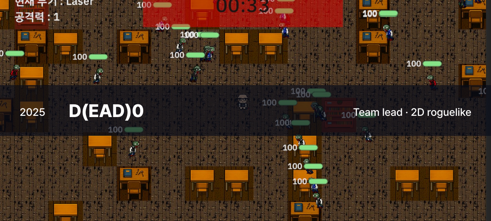</a>

- **[SoundVisualizer for Android](https://github.com/SOVIS-Team/SoundVisualizer-Android)** · team lead, the whole app An overlay app that draws the direction, loudness and kind of the sounds on your phone. 18 releases, 832 automated tests, 18 languages. Tested with six students at the Seoul National School for the Deaf.
- **[SoundVisualizer for Windows](https://github.com/SOVIS-Team/SoundVisualizer-Windows)** · team lead, overlay and screens The same idea on a PC. It draws direction for up to 7.1 channels and has 1,311 automated tests.
- **[Android Panel](https://github.com/amophi/android-panel)** · solo A VS Code extension that mirrors a connected Android device in the sidebar and lets you drive it. A touch now reaches the device in 2 ms instead of 70 ms. On the [Marketplace](https://marketplace.visualstudio.com/items?itemName=amophi.android-panel) and Open VSX.
- **[Solarljos](https://github.com/amophi/Solarljos)** · solo Finds files you deleted or saved over in the copies Windows and your programs keep, and brings them back. It writes nothing except the files you choose to restore.
- **[Welcome to Pildong Convenience Store!](https://yj720.itch.io/the-ultimate-hardcore-convenience-store)** · team lead, design and code A 2D store-management game: six days to earn five stars. Available on itch.io.
- **[High School High Score](https://github.com/DguFarmSystem/4th-game-High-School-High-Score)** · minigame development A minigame collection made by a team of six.
- **[GCS Nirvana Express](https://www.gcsweb.kr)** · back end and front end A commerce and community platform for the International Buddhism Expo, built by a team of 32 and in operation.
- **[D(ead)0](https://github.com/amophi/Netson)** · team lead, design and code A 2D roguelike made by a team of four.

Now in the works: **Hero Ball**, a team-versus-team multiplayer game, and **SwapStay**, a home-exchange platform.

 

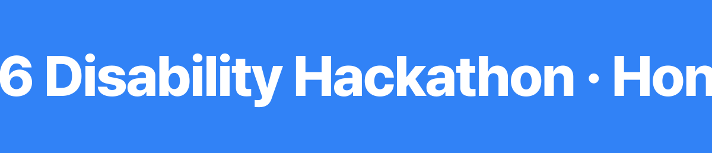

Awards and certificates from 2026. Team SOVIS won all three awards with SoundVisualizer. The contest names are my translations.

### About

<table>
<tr>
<td width="34%" valign="top">
Work <b>SureSoft Tech · intern</b>  
School <b>Dongguk University, Computer Science and AI</b>  
Team <b>SOVIS · team lead</b>
</td>
<td valign="top">
I started by making games, and these days most of my time goes into drawing sound on screens. I like to measure first and fix second. When I fix a bug I leave a test that fails on the old code, and when I ship I write down what I checked and what I could not check. When the tool I need does not exist, I build it. Since September 2026 I have been an intern at SureSoft Tech, working on features, performance testing and tuning, and AI integration for in-house systems.
</td>
</tr>
<tr>
<td valign="top">Awards</td>
<td valign="top">
Honorable Mention, 2026 Disability Hackathon · Korea Foundation for Persons with Disabilities · Nov 2026 
Encouragement Prize, 13th National ICT Convergence Contest · Chungbuk AI Industry Association · Sep 2026 
Silver Prize, 2026 Dalseo National University Student AI Idea Contest · Dalseo-gu, Daegu · Aug 2026
</td>
</tr>
<tr>
<td valign="top">Certificates</td>
<td valign="top">
SQLD · Sep 2026 
ADsP · Aug 2026 
AWS Certified AI Practitioner · Aug 2026 
TOEIC 930 · TOEFL ITP 610
</td>
</tr>
<tr>
<td valign="top">Tools</td>
<td valign="top">
Kotlin · C# · C++ · Python · JavaScript, TypeScript · Java · SQL 
Android (Jetpack Compose, JNI) · .NET WPF, Win32 · VS Code extensions · Unity, Photon 
ONNX Runtime · YAMNet · audio signal processing · React, Next.js · Spring Boot · PostgreSQL
</td>
</tr>
</table>

 

<a href="mailto:nawwhod@gmail.com">
<picture>
  <source media="(prefers-color-scheme: dark)" srcset="assets/en/contact-dark.svg">
  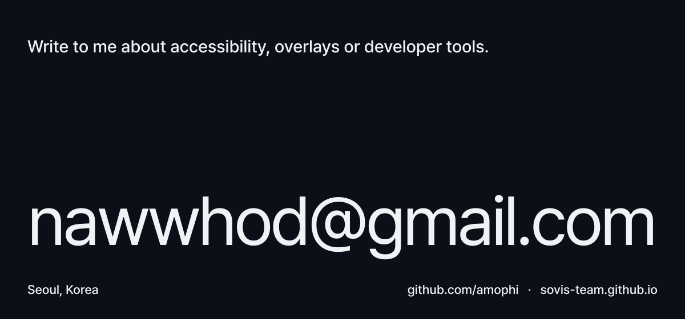
</picture>
</a>

The film scenes are from <i>Tears of Steel</i> by the Blender Foundation (CC BY 3.0, mango.blender.org); the overlay on them is what SoundVisualizer really drew. The game pictures are real screenshots of each game. The typeface is Pretendard (SIL OFL 1.1). The graphics on this page are made by <a href="tools/build.py">tools/build.py</a>.
