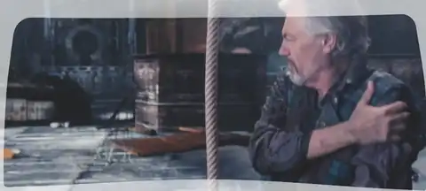
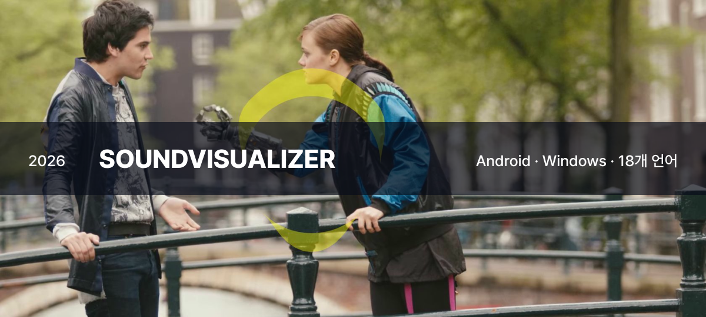
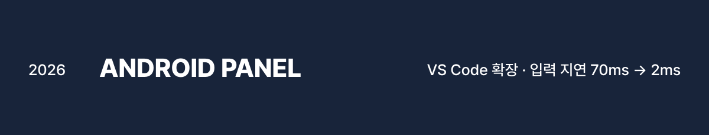
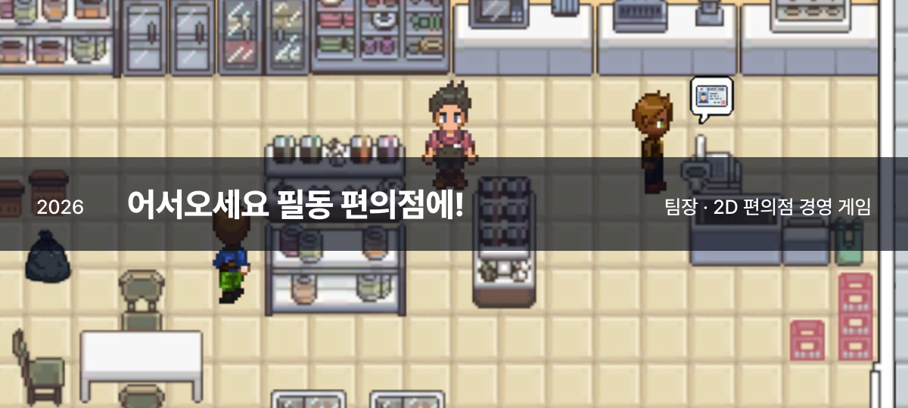
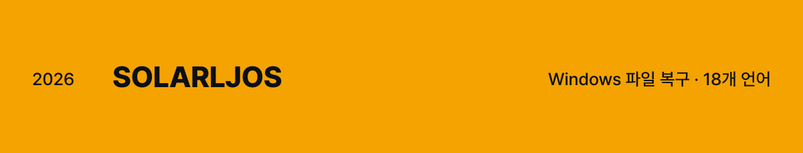
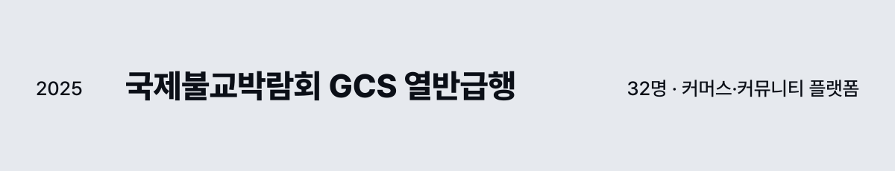
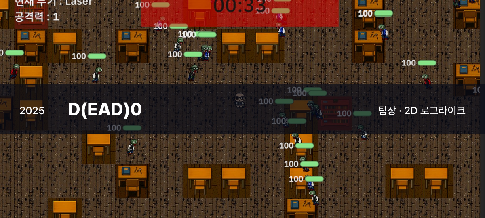
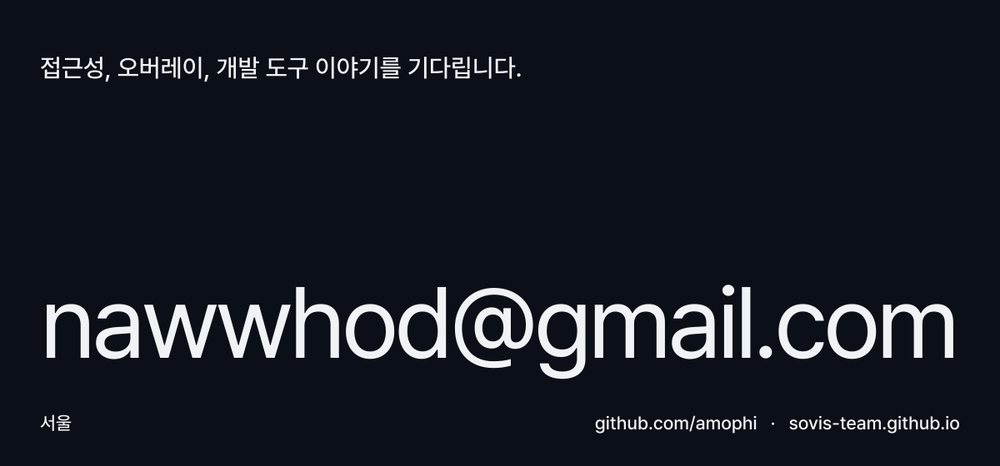

<b>한국어</b> · <a href="README.en.md">English</a>

청각장애인과 난청 사용자를 위한 접근성 앱 **SoundVisualizer**를 만듭니다.
[Android](https://github.com/SOVIS-Team/SoundVisualizer-Android) · [Windows](https://github.com/SOVIS-Team/SoundVisualizer-Windows) · [웹사이트](https://sovis-team.github.io/) · [소개 영상](https://youtu.be/Rl8BLXjoTv4)

 

<picture>
  <source media="(prefers-color-scheme: dark)" srcset="assets/ko/showcase-dark.svg">
  
</picture>

SoundVisualizer는 기기에서 나는 소리를 받아, 소리가 **어느 쪽에서**, **얼마나 크게**, **어떤 종류로** 나는지를 화면 가장자리에 그립니다. 영상, 음악, 게임 등 어떤 화면 위에서든 동작하고, 터치와 클릭은 그대로 아래 앱으로 전달됩니다. 소리의 종류는 기기 안의 AI가 가려내며, 소리를 밖으로 보내지 않습니다.

소리를 선택하면 앱이 실제로 그린 화면을 볼 수 있습니다.

<b>환경음</b> · 흰색

 

음악, 빗소리, 자동차가 지나가는 소리처럼 주변에 깔리는 소리입니다. 소리가 클수록 가장자리의 물결이 두꺼워집니다.

<b>사람 소리</b> · 노란색

 

말소리와 웃음, 기침처럼 사람이 내는 소리입니다. 말이 시작되면 확정 판정 전에 노란색을 먼저 띄워 표시가 늦지 않게 합니다.

<b>위협음</b> · 빨간색

 

사이렌, 경보, 경적, 총소리 같은 소리입니다. 휴대폰에서는 진동으로도 알릴 수 있고, 화면이 잠겨 있으면 잠금 화면에 알림을 띄웁니다.

 

### 만든 것

- **[SoundVisualizer for Android](https://github.com/SOVIS-Team/SoundVisualizer-Android)** · 팀장, 앱 전체 화면의 소리를 방향·크기·종류로 그리는 오버레이 앱입니다. 릴리스 18회, 자동 시험 832개, 18개 언어. 국립서울농학교 학생 6명과 함께 확인했습니다.
- **[SoundVisualizer for Windows](https://github.com/SOVIS-Team/SoundVisualizer-Windows)** · 팀장, 오버레이와 화면 같은 일을 PC에서 합니다. 7.1채널까지 방향을 그리고, 자동 시험은 1,311개입니다.
- **[Android Panel](https://github.com/amophi/android-panel)** · 혼자 연결한 Android 기기를 VS Code 사이드바에서 보고 조작하는 확장입니다. 입력이 기기에 닿는 시간을 70ms에서 2ms로 줄였습니다. [Marketplace](https://marketplace.visualstudio.com/items?itemName=amophi.android-panel)와 Open VSX에 있습니다.
- **[Solarljos](https://github.com/amophi/Solarljos)** · 혼자 지우거나 덮어쓴 파일을 Windows와 프로그램들이 남겨 둔 사본에서 찾아 되살립니다. 되살릴 파일 말고는 아무것도 쓰지 않습니다.
- **[어서오세요 필동 편의점에!](https://yj720.itch.io/the-ultimate-hardcore-convenience-store)** · 팀장, 기획·개발 엿새 안에 별 다섯 개를 채워야 하는 2D 편의점 경영 게임입니다. itch.io에서 받을 수 있습니다.
- **[하이스쿨 하이스코어](https://github.com/DguFarmSystem/4th-game-High-School-High-Score)** · 미니게임 개발 6명이 함께 만든 미니게임 모음입니다.
- **[국제불교박람회 GCS 열반급행](https://www.gcsweb.kr)** · 백엔드·프론트 32명이 함께 만들어 운영 중인 커머스·커뮤니티 플랫폼입니다.
- **[D(ead)0](https://github.com/amophi/Netson)** · 팀장, 기획·개발 4명이 만든 2D 로그라이크입니다.

지금은 여럿이 편을 나눠 겨루는 멀티플레이 게임 **Hero Ball**과 집 교환 플랫폼 **SwapStay**를 만들고 있습니다.

 

2026년에 받은 상과 자격입니다. 상은 모두 팀 SOVIS가 SoundVisualizer로 받았습니다.

### 소개

<table>
<tr>
<td width="34%" valign="top">
소속 <b>슈어소프트테크 · 인턴</b>  
학교 <b>동국대학교 컴퓨터AI학부</b>  
팀 <b>SOVIS · 팀장</b>
</td>
<td valign="top">
게임을 만들며 개발을 시작했고, 지금은 소리를 화면에 그리는 일에 가장 많은 시간을 씁니다. 재 보고 고치는 방식을 좋아합니다. 고친 결함에는 고치기 전 코드에서 실패하는 시험을 남기고, 배포할 때는 확인한 것과 확인하지 못한 것을 함께 적습니다. 필요한 도구가 없으면 직접 만듭니다. 2026년 9월부터 슈어소프트테크에서 사내 시스템의 기능 개발, 성능 시험과 최적화, AI 연동을 맡고 있습니다.
</td>
</tr>
<tr>
<td valign="top">수상</td>
<td valign="top">
2026 장애인 분야 해커톤 입선 · 한국장애인재단 · 2026.11 
제13회 전국 ICT융합 공모전 장려상 · 충북과학기술혁신원, 충북인공지능산업협회 · 2026.09 
2026 달서 전국 대학생 AI활용 아이디어 콘테스트 은상 · 대구광역시 달서구 · 2026.08
</td>
</tr>
<tr>
<td valign="top">자격 · 어학</td>
<td valign="top">
SQLD · 2026.09 
ADsP · 2026.08 
AWS Certified AI Practitioner · 2026.08 
TOEIC 930 · TOEFL ITP 610
</td>
</tr>
<tr>
<td valign="top">쓰는 것</td>
<td valign="top">
Kotlin · C# · C++ · Python · JavaScript, TypeScript · Java · SQL 
Android (Jetpack Compose, JNI) · .NET WPF, Win32 · VS Code 확장 · Unity, Photon 
ONNX Runtime · YAMNet · 오디오 신호 처리 · React, Next.js · Spring Boot · PostgreSQL
</td>
</tr>
</table>

 

<a href="mailto:nawwhod@gmail.com">
<picture>
  <source media="(prefers-color-scheme: dark)" srcset="assets/ko/contact-dark.svg">
  
</picture>
</a>

그림 속 영화 장면은 Blender Foundation의 〈Tears of Steel〉(CC BY 3.0, mango.blender.org)이고, 그 위의 오버레이는 SoundVisualizer가 실제로 그린 것입니다. 게임 화면은 각 게임의 실제 화면입니다. 글꼴은 Pretendard(SIL OFL 1.1)입니다. 이 페이지의 그림은 <a href="tools/build.py">tools/build.py</a>로 만듭니다.
